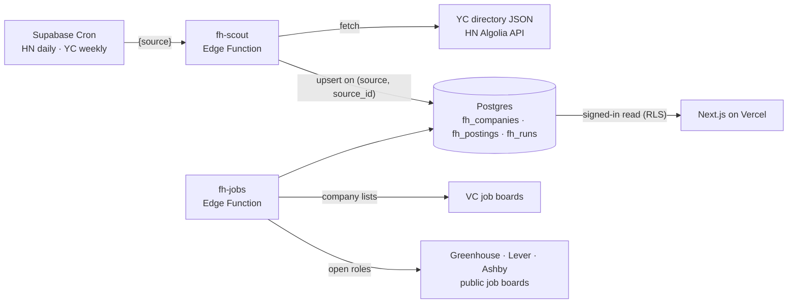

# Foothold

Foothold helps a person find the startups, the roles and the people that fit them, from their own resume. Every judgment quotes its source. The first users are students: it started from students curious about startups whose background isn't a direct match, and that is who v1 is tested with.

Design, Build, Ship (MPCS 51238, Autumn 2026) · **Final project**, focus: **AI**. v1 is due November 17, v2 at the project fair on December 1.

- **Proposal:** [dbs-proposal-xi.vercel.app](https://dbs-proposal-xi.vercel.app) ([repo](https://github.com/jessieyiqichen/dbs-proposal)), with three user interviews
- **This week's plan:** [docs/v1-plan.md](docs/v1-plan.md) · **Who owns what, and the agent harness:** [docs/ownership.md](docs/ownership.md), [AGENTS.md](AGENTS.md) · **Log:** [log.md](log.md)
- **Built on:** Assignment 5's worker and Realtime ([docs/README-a5.md](docs/README-a5.md)) and Assignment 4's job board code and goal tables ([docs/README-a4.md](docs/README-a4.md)). Same Clerk app and Supabase project; Foothold's tables start with `fh_` and the earlier tables are untouched.

## Status (November 10)

| Part | State |
|---|---|
| Company and posting data | **Working.** 4,413 active YC companies and 206 postings from the November "Who is hiring" thread are in the database; Cron re-reads HN daily and YC weekly |
| Jobs from company job boards (Greenhouse, Lever, Ashby) and VC portfolio lists | In progress |
| Judge (new grads: yes / maybe / no, with the quote) and its eval | Not started. The 40-posting eval set is in [evals/new-grad](evals/new-grad), pre-labeled and waiting for my review |
| Resume profile, "your way in", who to contact | Not started |
| Team room and cards (New / Saved / Reached out) | Not started |
| Deployed | Not yet |

The pages in `src/` are still Assignment 5's; they are replaced as the parts above land.

## What it will do

Four agents with one job each, reporting into one room, and a card per company as the result:

| Agent | Job | How it is measured |
|---|---|---|
| Scout | Finds companies and postings from YC, Hacker News, VC job boards and company job boards; merges the same company across sources | Same company merged correctly, 90%+ |
| Judge | Reads a posting and says what level it is and what it strictly requires, quoting the sentences it relied on. It labels; it never hides a role | Its level agrees with my labels on 40 postings, 80%+ |
| Insider | Writes "your way in": one line from your resume against one fact about the company | Every quote exists in the posting or the resume, 100% (checked automatically) |
| Connector | Names one person to contact: the founder, or whoever posted the job on Hacker News | Of 5 classmates who sign up, 2 reach out |

You send the message yourself. Foothold never sends anything for you and never scrapes LinkedIn or Wellfound.

## How the data moves



| Table | Holds | Who writes |
|---|---|---|
| `fh_companies` | One row per company per list it came from: name, domain, one-liner, tags, team size, whether it is hiring | The workers only |
| `fh_postings` | One row per posting: company, title, text, link, emails found in it, the poster | The workers only |
| `fh_runs` | One row per worker run: source, rows written, error | The workers only |

Signed-in people can read companies and postings; nobody but the workers can write (row-level security, see [supabase/migrations](supabase/migrations)).

## Sources, and what is off limits

| Source | How | Status |
|---|---|---|
| YC directory | Community JSON ([yc-oss/api](https://github.com/yc-oss/api)) | In |
| Hacker News "Who is hiring" | HN Algolia API | In |
| Company job boards | Public Greenhouse, Lever and Ashby endpoints, no key needed | In progress |
| VC job boards (the ~45 channels in an a16z partner's list) | Company lists only; roles come from each company's own board | In progress |
| LinkedIn, Wellfound, Fast AI Jobs | Never crawled. A card links out instead | By design |

## Run it

```bash
npm ci
```

```bash
npm test
```

```bash
npm run dev
```

`.env.local` needs the Clerk and Supabase keys (the same names as Assignment 5) and, for the Judge, `GEMINI_API_KEY`. Workers are deployed with the Supabase MCP server scoped to this one project; their logic lives in `supabase/functions/*/lib` so the same code runs in vitest and in the Edge Function.

## Tests

Parsers are tested on saved real responses in `supabase/functions/*/fixtures`. The Judge's eval set and its labeling rule are in [evals/new-grad/review.md](evals/new-grad/review.md).
