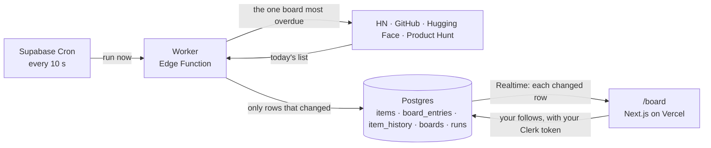

# Builder's Board

The leaderboards builders check every day (Hacker News, Show HN, GitHub trending, Hugging Face models and Daily Papers, Product Hunt) on one page that moves on its own: a worker checks each board every minute or so and saves only what changed, and every open page gets each change the moment it lands. Pick the boards and keywords you care about; each row draws its own last hour, and a row slides to its new place when its rank changes.

Design, Build, Ship · **Assignment 5 (Live Data System)**, built on the Assignment 4 code (same Clerk app, same Supabase project; A4's tables are untouched and [dbs-a4.vercel.app](https://dbs-a4.vercel.app) keeps working).

- **Live:** [dbs-a5.vercel.app/board](https://dbs-a5.vercel.app/board) (sign in with any email; Clerk is in development mode)
- **Data flow, drawn before the code:** [docs/data-flow.md](docs/data-flow.md) (what each part sends to the next, and what breaks if it changes)
- **Worker:** [supabase/functions/board-worker/](supabase/functions/board-worker/) · **Tables, Cron, Realtime, row-level security:** [supabase/migrations/](supabase/migrations/) (the `20261031…` and `20261101…` files)
- **Page:** [src/app/board/](src/app/board/), [src/components/board/](src/components/board/), [src/lib/board/](src/lib/board/)
- **Design system:** Tape & Tile, on Claude: https://claude.ai/artifact/AsfZpEUeZZtRjXrS8biY8J · **Where the look comes from:** [docs/references.md](docs/references.md)
- **Decision log (Chinese):** [log.md](log.md) · **Agent rules and data model:** [AGENTS.md](AGENTS.md) · **Assignment 4 README:** [docs/README-a4.md](docs/README-a4.md)

## How it moves



| Step | What happens | Where |
|---|---|---|
| Every 10 seconds | Cron calls the worker. The worker claims the one board whose next check is most overdue (each board has its own interval: HN 60 s, Product Hunt 60 s, GitHub and Hugging Face 5 min) or does nothing | [cron migration](supabase/migrations/20261031180000_cron_calls_worker_every_10_seconds.sql), `claim_next_board` |
| Fetch and parse | One request (or 31 for HN: the id list, then each story). Every value from outside is checked; a row with no id, no title or a link that is not https is dropped | [lib/fetch.ts](supabase/functions/board-worker/lib/fetch.ts), [lib/parse.ts](supabase/functions/board-worker/lib/parse.ts) |
| Diff | Compared with what is stored: only items whose title, score or comments changed, only ranks that moved, a history row for each score change | [lib/diff.ts](supabase/functions/board-worker/lib/diff.ts), [lib/run.ts](supabase/functions/board-worker/lib/run.ts) |
| Write | Upserts keyed on (source, id). A database trigger sets the item's rise over the last hour in the same write. Then one `boards` update (checked at, ok or failed) and one `runs` row | [store.ts](supabase/functions/board-worker/store.ts), [rise migration](supabase/migrations/20261101050000_rise_in_the_same_write.sql) |
| Push | Realtime sends each changed row of `items`, `board_entries` and `boards` to every open page. The page applies it to the one row it concerns and never re-reads the whole board | [feed.ts](src/lib/board/feed.ts), [live.ts](src/lib/board/live.ts) |

**Why "only what changed" matters:** every written row is a Realtime message to every open page, and the free tier allows 2 million a month. A run that rewrote all 30 rows would spend the month's quota in days; a run that writes the 3 rows that moved does not. The same test proves it: the worker run twice on the same saved page writes 0 rows the second time ([run.test.ts](supabase/functions/board-worker/lib/run.test.ts)).

## What you see

| On the page | What it is |
|---|---|
| Poster banner | The title as one line of condensed capitals across a taped sheet, a strip of tiles the data lays out under it, and the board that rose most this hour stamped over the title's end; a shape turns when its board moves |
| Tabs | Two rows: the followed boards (and "+" to add one), then the tabs across boards, All changes and Saved (and "Keywords"). A closed tab shows how many times its board moved while you were on another |
| A board | Its ranking, as a browser window. Each row: rank, title, the source's one-line description, a step line of that item's own last hour on its own scale (the latest step in red), its score, and a Save key (pressed, in mustard, once saved). A row slides to its new place when its rank changes; the score flashes when it moves |
| All changes | Every followed board's changes this hour in one feed, latest first, with the pulse: one note per change, minute by minute, per board |
| Saved | The items you pressed Save on, newest first, from any board. An item stays after it leaves its board, with "off the board" in place of its rank, and its score keeps moving with Realtime like any other |
| Following | Beside the tabs, "+" opens a sheet over the board with the boards not yet followed (one press adds it and opens its tab) and "Keywords" opens one for the words to pick out, each with a count of how many rows it matches now; a board's window has a pressed "Following" key that lets it go. Only the first visit, with nothing followed yet, shows the full-page chooser. Saved to your account, seen only by you |

## Live, stale, down

The page shows which of four states each board is in, worked out every 5 seconds from `boards.last_checked_at` and `last_status` ([freshness.ts](src/lib/board/freshness.ts)):

| State | When | Shown as |
|---|---|---|
| Loading | Never checked yet | "waiting for its first check" |
| Fresh | Checked within its interval | "updated 12s ago", blue dot |
| Stale | Three intervals with no check: the worker or Cron has stopped (wins over down: an old failure says nothing about now) | "not updating · checked 4m ago", hatched header, a note that the numbers may be out of date |
| Down | The last check failed (the site answered 503, changed its page, the token expired) | "last check failed · 5s ago", red dot, the error under it, the last good rows still shown |

Both were checked by hand: Product Hunt was set to `failed` in the database (down appeared within 5 s) and then left unchecked for three minutes (stale took over). Down then happened for real: on 2026-11-01, the day US clocks fell back, the worker read Los Angeles's offset from "now" and placed Product Hunt's midnight an hour late, so the API answered with no posts from 09:00Z on. The page showed the last good ranking with the error under the header, as designed; the fix reads the offset at that midnight instead ([log.md](log.md), 2026-11-01).

## The free tier, measured

One hour on 2026-11-01, before the rise fix: 257 worker runs wrote 1,712 rows, so an open page received about 2,000 Realtime messages an hour. One page open around the clock would use 1.4 of the 2 million messages a month; five classmates looking for an hour a day use 300,000. Edge Function calls: Cron calls the worker 360 times an hour whether or not a board is due, about 260,000 a month of 500,000. Database: 18 MB of 500 MB, growing about 1 MB a day in `item_history`.

The same hour after the fix (15:33 to 16:33 UTC): 263 runs wrote 1,389 rows for 739 score changes (the rest are rank moves, mostly the HN front page reordering), and the five-minute rise refresh wrote about 180 rows an hour, so an open page received about 1,830 messages. Had the old code handled the same hour, each of the 739 score changes would have been a second write and the baselines would have been rewritten after every run, so at least 2,570 messages: the fix saves about 30% on a like-for-like hour. One page open around the clock is now 1.3 million messages a month; the HN front page remains two thirds of all writes, so its interval is the lever if that ever matters.

Most of the traffic was the "rise in the last hour" column: a score change was two writes (score, then rise), and after every run the rises of a whole board were recomputed as the hour-ago baseline moved (HN front page alone: 1,095 rows an hour). Now a trigger sets the rise in the same write as the score, and Cron recomputes standing rises every 5 minutes instead of the worker after every run. Numbers and the reasoning: [log.md](log.md), 2026-11-01.

## Security

- **Keys:** the browser has only the Supabase publishable key and the Clerk publishable key (`NEXT_PUBLIC_…` in `.env.local`, git-ignored, and in Vercel). The worker writes with the project's secret key, which Supabase gives the function on its own servers; the Product Hunt token is a Supabase secret. Neither is in code or in this repo.
- **The worker needs no key from its caller** (`verify_jwt` off): calling it more often than Cron cannot make it fetch more, because `claim_next_board` only hands out a board that is due, and `boards`, `items` and the rest are not writable by signed-in users at all.
- **Row-level security:** signed-in people read the boards and the items; `follows` and `saves` have rules that compare `user_id` with the token's `sub`, so each person reads and changes only their own follows and saved items, and `user_id` is filled in by the database, never sent by the browser. `item_history` and `runs` are readable but never pushed (they are not in the Realtime publication).
- **Checked input:** every row from a site and every row from Supabase is checked before use; a bad row is dropped and counted, never shown.

## Testing

- **409 unit tests** (vitest, `npm test`): 27 for the worker (parsers on saved responses from each site, the diff, a run on an in-memory store, the Product Hunt query asks for VOTES order and starts its day at Los Angeles midnight even on the days the clocks change), 85 for the page's logic (reading and checking rows, applying Realtime changes, freshness, follows and keyword matching, saved items, trends and step lines, tabs, the poster mosaic and title), the rest from Assignment 4. External calls are always faked.
- **Checked in the browser, by hand:** Realtime stayed connected across Clerk's 60-second token life (the first version dropped at exactly 60 s; the fix refreshes the token when less than 30 s is left and rejoins after a close); a rank swap written straight to the database moved the rows on screen; down and stale as above.

## Running it

```bash
npm install
npm run dev
```

`.env.local` needs `NEXT_PUBLIC_SUPABASE_URL`, `NEXT_PUBLIC_SUPABASE_PUBLISHABLE_KEY` and the Clerk keys from Assignment 4. The worker runs on Supabase, not locally: it is deployed from [supabase/functions/board-worker/](supabase/functions/board-worker/) and needs `PRODUCTHUNT_TOKEN` in the function's secrets.
