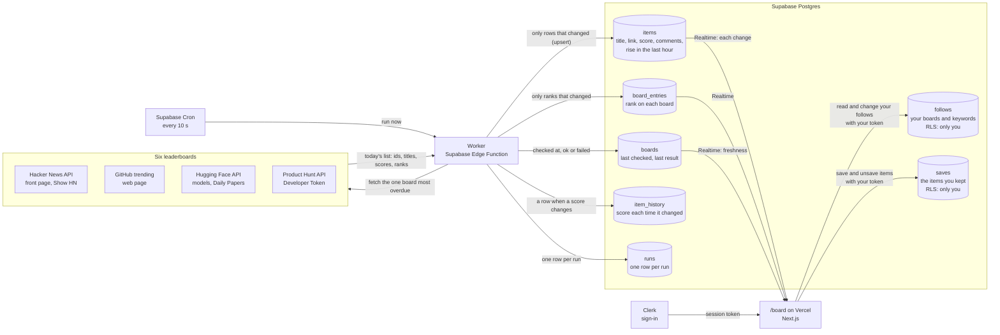

# Data flow · Builder's Board (Assignment 5)

Drawn on 2026-10-31, before any worker or page code was written. It is the plan the code follows; when the code changes the flow, this file changes with it.

## What each part sends to the next, and what breaks if it changes

| Step | Sends | If it changes or stops |
|---|---|---|
| Supabase Cron → worker | "Run now", every 10 seconds | Cron stops: nothing new is fetched. `boards.last_checked_at` stops moving, so after a few missed checks the page shows **stale**, not a frozen board pretending to be live |
| Worker → leaderboards | One board per run: the one whose next check is most overdue. Each board has its own interval (GitHub and Hugging Face models change slowly, so every 5 minutes) | Too fast: a site slows us down or blocks us. A new token is needed: Product Hunt fails until `PRODUCTHUNT_TOKEN` is set |
| Leaderboards → worker | Today's list: ids, titles, links, a score (points, stars, likes, upvotes, replies or votes), comments, order | A site changes its format (most likely GitHub, which is read from the web page): the worker finds no rows, marks that run **failed** and keeps the last good rows. That board shows **down**; the other six keep updating |
| Worker → `items`, `board_entries` | Only rows whose title, score, comments or rank changed, with an upsert keyed on (source, id) | Writing every row each run: the board still looks right, but every unchanged row becomes a Realtime message and the free tier's monthly quota is gone in hours |
| Worker → `item_history` | A row when an item's score changes | Without it there is no "rise in the last hour", the one thing none of the original sites show |
| Database → `items.rise_1h` | A trigger sets the rise in the same write as the score (one Realtime message, not two); Cron recomputes every board's standing rises every 5 minutes as the hour-ago baseline moves | Refreshing after every run, as it first did, was most of the traffic: hn_front alone 1,095 row writes an hour, each a message to every open page |
| Worker → `boards`, `runs` | When it checked each board, whether it worked, how many rows changed | Without these the page cannot tell fresh from stale from down |
| Clerk → page | Who is signed in, as a token Supabase trusts | Clerk keys or the Supabase third-party auth setting change: sign-in still works, but every read of `follows` returns nothing |
| Page → `follows`, `saves` | Which boards and keywords you follow, and which items you kept (added 2026-11-01), written with your own token | RLS lets each person read and change only their own rows; a missing policy means you see nothing, with no error. A saved item's row in `items` is never deleted, so it stays readable after leaving its board |
| Realtime → page | Each change to `items`, `board_entries`, `boards` | Realtime needs three things: the table added to the publication, read access granted, and an RLS policy that lets the person read it. Any one missing: the page gets nothing, with no error |

## Freshness, as the page shows it

| State | When |
|---|---|
| Loading | The first read has not come back yet |
| Fresh | The board was checked within its interval |
| Stale | No check for three of its intervals (the worker or Cron has stopped) |
| Down | The board's last run failed (the site changed or refused us) |

The worker is not a user: it writes with the Supabase secret key, which Supabase gives the function on its own servers and which never appears in the code.
